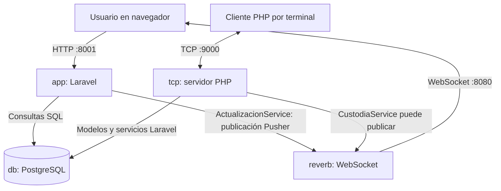
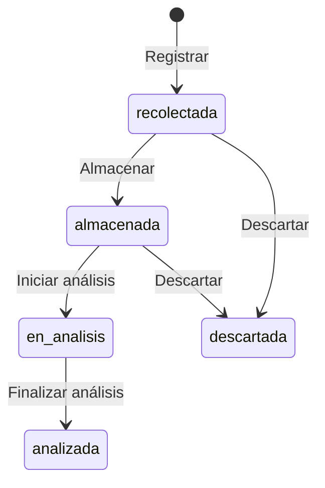
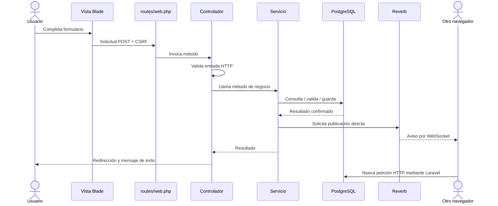

# EcoTrace — Sistema distribuido de trazabilidad de muestras ambientales

> **Proyecto académico de Aplicaciones Distribuidas**  
> **Tecnologías:** Laravel 13, PHP 8.4, PostgreSQL 17, Docker Compose, Blade, Reverb, Pusher (PHP y JavaScript) y sockets TCP.  
> **Organización:** MVC + capa de servicios + principios SOLID.  
> **Restricción del proyecto:** no se crean clases en `App\Events` ni se utiliza `Event::dispatch()` para las operaciones.

## 1. ¿Qué problema resuelve?

EcoTrace permite registrar muestras ambientales (agua, suelo, aire y vegetación) y seguir su ciclo de vida desde la recolección hasta el análisis o descarte. La aplicación registra **quién tiene la custodia de cada muestra**, el historial de transferencias y los resultados de laboratorio.

Se eligió un sistema con estados y restricciones de negocio para demostrar algo más que operaciones CRUD: **una transferencia o un análisis solo son válidos cuando se cumplen determinadas condiciones**.

### Funcionalidades

| Módulo | Qué hace | Clase principal de negocio |
|---|---|---|
| Muestras | Registrar, consultar, almacenar y descartar | `MuestraService` |
| Custodia | Cambiar el responsable y guardar el historial | `CustodiaService` |
| Análisis | Iniciar y finalizar el análisis | `AnalisisService` |
| Tiempo real | Avisar a otras ventanas sobre un cambio | `ActualizacionService` |
| Consola | Consultar o transferir sin usar el navegador | `routes/console.php` |
| Socket TCP | Recibir comandos de clientes conectados | `scripts/servidor-tcp.php` |

---

## 2. Arquitectura: ¿por qué es distribuido?

La aplicación está dividida en **procesos/servicios de Docker que se comunican por red**. El navegador ve un único sistema, aunque los datos y la comunicación se atienden en nodos distintos.



**Nota:** `app`, `db`, `reverb` y `tcp` son servicios de Docker, no cuatro microservicios independientes con API propia. Laravel concentra las reglas de negocio y PostgreSQL actúa como fuente de verdad.

### Función de cada contenedor

| Servicio | Imagen / ejecución | Función | Puerto visible en Windows |
|---|---|---|---|
| `app` | Imagen del `Dockerfile`; `php artisan serve` | Atiende formularios, rutas y controladores | `8001` → `8000` |
| `db` | `postgres:17-alpine` | Guarda muestras, investigadores, transferencias y análisis | No se publica |
| `reverb` | Imagen del `Dockerfile`; `php artisan reverb:start` | Mantiene conexiones WebSocket | `8080` |
| `tcp` | Imagen del `Dockerfile`; `php scripts/servidor-tcp.php` | Atiende clientes TCP y comandos | `127.0.0.1:9000` |

En `docker-compose.yml`, los contenedores comparten una red privada creada por Compose. Por eso **`DB_HOST=db`** y **`REVERB_HOST=reverb`** son nombres internos válidos: `localhost` desde `app` apuntaría a `app`, no a PostgreSQL ni a Reverb.

El `Dockerfile` configura PHP y sus extensiones (`pdo_pgsql`, `pcntl`, etc.), pero **no instala por sí solo los paquetes Composer**. Los paquetes deben estar declarados en `composer.json` e instalados en `vendor/` mediante `composer install` o `composer require`.

---

## 3. Organización del código

```text
EcoTrace/
├── app/
│   ├── Http/Controllers/
│   │   ├── MuestraController.php       # Vistas y acciones sobre muestras
│   │   ├── CustodiaController.php      # Peticiones de transferencia
│   │   └── AnalisisController.php      # Peticiones de análisis
│   ├── Models/
│   │   ├── Muestra.php                 # Tabla muestras y relaciones
│   │   ├── Investigador.php           # Responsables
│   │   ├── Transferencia.php           # Historial de custodia
│   │   └── Analisis.php                # Resultados de laboratorio
│   └── Services/
│       ├── MuestraService.php         # Crear, consultar, almacenar, descartar
│       ├── CustodiaService.php        # Validar y transferir custodia
│       ├── AnalisisService.php        # Iniciar y finalizar análisis
│       └── ActualizacionService.php   # Publicación directa a Reverb
├── database/
│   ├── migrations/                    # Definición de tablas
│   └── seeders/                       # Datos iniciales
├── resources/views/
│   ├── layouts/app.blade.php          # Estructura y estilos comunes
│   └── muestras/
│       ├── index.blade.php            # Panel y listado
│       ├── create.blade.php           # Registro
│       └── show.blade.php             # Detalle, custodia, análisis e historial
├── routes/
│   ├── web.php                        # Rutas HTTP
│   └── console.php                    # Comandos Artisan
├── scripts/
│   ├── servidor-tcp.php               # Servidor TCP multicliente
│   └── cliente-tcp.php                # Cliente TCP interactivo
├── config/reverb.php                  # Configuración de Reverb (si está publicada)
├── Dockerfile
├── docker-compose.yml
├── composer.json
└── .env                                 # Variables locales; no subir a Git
```

Las vistas usan `@extends('layouts.app')`: el layout contiene cabecera, estilos y la zona `@yield('content')`, mientras las vistas colocan su contenido con `@section('content')`.

**Decisión de organización:** si el JavaScript de Reverb está directamente en `index.blade.php` y `show.blade.php` (como se decidió para este proyecto), cada vista establece su propia suscripción. No hacen falta `partials`, `@push` ni `@stack`. Si aún conservas el script en `layouts/app.blade.php`, no lo dupliques en las vistas: podría crear conexiones innecesarias o recargas repetidas.

---

## 4. Modelo de datos y persistencia

### Tablas

**`investigadores`**: `id`, `nombre`, `email` y marcas de tiempo.  
**`muestras`**: `id`, `codigo`, `tipo`, `origen`, `lugar_recoleccion`, `fecha_recoleccion`, `estado`, `observaciones`, `responsable_id` y marcas de tiempo.  
**`transferencias`**: `id`, `muestra_id`, `origen_investigador_id`, `destino_investigador_id`, `motivo` y marcas de tiempo.  
**`analisis`**: `id`, `muestra_id`, `investigador_id`, `resultado`, `fecha_analisis` y marcas de tiempo.

### Relaciones Eloquent

| Método | Relación | Interpretación |
|---|---|---|
| `Muestra::responsable()` | `belongsTo(Investigador::class)` | Una muestra tiene un custodio actual |
| `Muestra::transferencias()` | `hasMany(Transferencia::class)` | Una muestra puede cambiar de responsable varias veces |
| `Muestra::analisis()` | `hasOne(Analisis::class)` | Una muestra tiene como máximo un análisis final registrado |
| `Transferencia::origen()` | `belongsTo(Investigador::class)` | Responsable anterior |
| `Transferencia::destino()` | `belongsTo(Investigador::class)` | Responsable nuevo |
| `Analisis::investigador()` | `belongsTo(Investigador::class)` | Quien registró el resultado |

Las **migraciones** guardan la estructura de la base en código. Los **seeders** cargan investigadores y cinco muestras para la demostración (`M-001` a `M-005`). Los **modelos Eloquent** permiten consultar y modificar registros desde Laravel sin escribir SQL para cada operación.

### Ciclo de vida de una muestra



**Reglas de negocio principales:**

1. Una muestra recién registrada comienza en `recolectada`.
2. Solo una muestra `recolectada` puede pasar a `almacenada`.
3. Solo una muestra `almacenada` puede iniciar el análisis.
4. Solo una muestra `en_analisis` puede finalizar el análisis; el investigador indicado debe ser el custodio actual.
5. Una muestra solo puede transferirse estando `recolectada` o `almacenada`, y no puede transferirse a su mismo responsable.
6. Solo una muestra `recolectada` o `almacenada` puede descartarse.

Estas reglas **viven en los servicios**, no en las vistas, y se aplican también cuando la operación llega desde Artisan o TCP.

---

## 5. Flujo general: de la vista a la base de datos



**Interpretación:** la vista no habla directamente con PostgreSQL ni ejecuta reglas de negocio. El controlador transforma una petición HTTP en una llamada al servicio; el servicio decide si la operación es válida y utiliza modelos Eloquent para persistir los cambios.

### 5.1 Rutas y métodos más importantes

| HTTP | URL | Controlador / método | Servicio |
|---|---|---|---|
| GET | `/muestras` | `MuestraController@index` | Consulta Eloquent para el listado |
| GET | `/muestras/crear` | `MuestraController@create` | Muestra el formulario |
| POST | `/muestras` | `MuestraController@store` | `MuestraService::crear()` |
| GET | `/muestras/{muestra}` | `MuestraController@show` | Consulta de relaciones Eloquent |
| POST | `/muestras/{muestra}/almacenar` | `MuestraController@almacenar` | `MuestraService::almacenar()` |
| POST | `/muestras/{muestra}/descartar` | `MuestraController@descartar` | `MuestraService::descartar()` |
| POST | `/muestras/{muestra}/transferir` | `CustodiaController@transferir` | `CustodiaService::transferir()` |
| POST | `/muestras/{muestra}/analisis/iniciar` | `AnalisisController@iniciar` | `AnalisisService::iniciar()` |
| POST | `/muestras/{muestra}/analisis/finalizar` | `AnalisisController@finalizar` | `AnalisisService::finalizar()` |

El parámetro `{muestra}` utiliza **Route Model Binding**: Laravel localiza la muestra y se la entrega al controlador como objeto `Muestra`.

### 5.2 Ejemplo completo: transferir una muestra

**1) Vista:** en `show.blade.php`, el usuario elige un nuevo investigador y escribe el motivo. El formulario envía un `POST` a `route('muestras.transferir', $muestra)` junto con `@csrf`.

**2) Ruta:** `routes/web.php` asocia esa petición con `CustodiaController::transferir()`.

**3) Controlador:** recibe `Request`, `Muestra` y `CustodiaService $servicio`; comprueba que existe el investigador destino y que el motivo cumple las reglas de formato:

```php
$datos = $request->validate([
    'destino_investigador_id' => ['required', 'integer', 'exists:investigadores,id'],
    'motivo' => ['required', 'string', 'max:200'],
]);

$servicio->transferir(
    $muestra,
    (int) $datos['destino_investigador_id'],
    $datos['motivo']
);
```

**4) Servicio:** `CustodiaService::transferir()` consulta la muestra con `lockForUpdate()`, comprueba el estado y que el destino sea distinto del custodio actual. Luego inserta una fila en `transferencias` y actualiza `muestras.responsable_id`.

**5) Transacción:** esos dos cambios se realizan dentro de `DB::transaction()`. Si falla una parte, la transacción se revierte y no se guarda un historial incoherente.

**6) Notificación:** una vez confirmada la transacción, `ActualizacionService::notificar('Custodia transferida')` intenta publicar el aviso a Reverb.

**7) Respuesta:** el controlador redirige y muestra «Custodia transferida y registrada en el historial». Si el servicio lanza una `DomainException`, el controlador la captura y muestra un mensaje de error.

Este es **el mejor flujo para exponer en clase**, porque permite explicar ruta, controlador, servicio, modelo, relaciones, transacción, validación, excepción, persistencia y comunicación entre nodos.

### 5.3 Flujo de registro y código automático `M-001`, `M-002`…

El código debe generarse **en el servidor** para que no dependa de lo que envíe el navegador.

- **Implementación de generación al guardar (incluida en la revisión del proyecto):** `MuestraService::crear()` guarda la muestra, recibe el `id` de PostgreSQL y construye `M-` + ID con al menos tres dígitos: `6 → M-006`, `15 → M-015`, `1000 → M-1000`. El campo `codigo` permite un `NULL` temporal mediante una migración adicional, y el servicio asigna el valor definitivo dentro de una transacción.
- **Si aplicaste el ajuste posterior para previsualizar el código en el formulario:** `MuestraController::create()` reserva un ID mediante la secuencia de PostgreSQL (`nextval`), calcula el código que se muestra en un campo `readonly` y envía la reserva cifrada; `store()` la valida y el servicio utiliza ese ID reservado al guardar. Este último ajuste **fue propuesto después del ZIP** y debe comprobarse en tus archivos locales: no se puede asumir que ya está aplicado. Requiere validar adecuadamente el token y manejar formularios viejos o reutilizados.

**Importante:** un campo `readonly` es solo una protección visual: el navegador puede manipularse. Por eso, el servicio debe ignorar cualquier `codigo` enviado por el usuario y determinar el valor definitivo en el backend. Una secuencia PostgreSQL puede dejar **saltos de numeración** si se reserva un ID y después no se usa. No se recomienda obtener el próximo código con `MAX(id) + 1` cuando existen usuarios concurrentes.

### 5.4 Flujo del análisis

- `AnalisisController::iniciar()` llama a `AnalisisService::iniciar()`. Si la muestra no está `almacenada`, el servicio rechaza la operación.
- `AnalisisController::finalizar()` valida investigador y resultado; `AnalisisService::finalizar()` verifica estado `en_analisis` y que el investigador coincida con el custodio.
- En una transacción se crea un `Analisis` y se modifica `Muestra.estado` a `analizada`.
- Después se avisa a Reverb y el controlador devuelve una confirmación.

---

## 6. ¿Cómo funcionan los WebSockets sin eventos Laravel?

**`ActualizacionService.php` no sustituye las reglas de negocio:** su única función es avisar a los navegadores después de cambios confirmados.

```php
$app = config('reverb.apps.apps.0');
$pusher = new \Pusher\Pusher(
    $app['key'], $app['secret'], $app['app_id'],
    [
        'host' => $app['options']['host'],
        'port' => (int) $app['options']['port'],
        'scheme' => 'http',
        'useTLS' => false,
    ]
);
$pusher->trigger('muestras', 'muestras.actualizadas', [
    'mensaje' => $mensaje,
    'hora' => now()->toDateTimeString(),
]);
```

Este código **publica directamente mediante la API compatible con Pusher**. Reverb envía el mensaje a quienes están suscritos al canal `muestras`. La palabra `event` aparece en el protocolo de comunicación, pero **no se crea ni despacha una clase de evento Laravel** (`App\Events`, `ShouldBroadcastNow`, `dispatch()`).

En el navegador, el código JavaScript hace algo equivalente a:

```javascript
const canal = pusher.subscribe('muestras');
canal.bind('muestras.actualizadas', (datos) => {
    console.log('Cambio recibido:', datos);
    window.location.reload();
});
```

Con el enfoque original, el JavaScript solo recarga automáticamente la página si `document.visibilityState === 'visible'`; si mantienes esa condición, una pestaña oculta puede no reflejar cambios hasta volver a ella o recargar. Si optaste por scripts en `index.blade.php` y `show.blade.php`, conserva **una única suscripción por página**. Evita recargar mientras el usuario está escribiendo datos importantes en un formulario sin guardar.

El aviso WebSocket **no sustituye a PostgreSQL**: después de recibirlo, la vista hace una nueva petición HTTP para leer los datos actualizados de la base.

### Diagnóstico de Reverb

Si se guardan datos pero no aparecen en otras ventanas, revisa, en este orden:

1. `docker compose ps`: ¿el servicio `reverb` está activo?
2. `docker compose exec app composer show pusher/pusher-php-server` y `docker compose exec app composer show laravel/reverb`: ¿están instalados los paquetes?
3. `config/reverb.php`: ¿existe y entrega una configuración válida?
4. En `F12 → Console`: ¿el WebSocket aparece como `connected` y la suscripción fue exitosa?
5. `docker compose exec app sh -c "tail -n 40 storage/logs/laravel.log"`: ¿hay advertencias de publicación?
6. `docker compose logs --tail=50 reverb`: ¿Reverb muestra errores?

Errores observados durante la implementación:

| Error | Causa | Corrección |
|---|---|---|
| `Class "Pusher\\Pusher" not found` | Falta el paquete PHP Pusher | `docker compose exec app composer require pusher/pusher-php-server` |
| `Trying to access array offset on null` desde `ActualizacionService` | `config('reverb.apps.apps.0')` devuelve `null` | Instalar `laravel/reverb`, publicar/verificar `config/reverb.php`, limpiar caché |
| `MissingAppKeyException` | No se ha generado `APP_KEY` | `docker compose exec app php artisan key:generate` |
| Tinker muestra `= null` tras `notificar()` | El método devuelve `void` | Es normal; **no confirma que se publicó** |

El servicio original captura `Throwable` y escribe `logger()->warning(...)` si falla la publicación. Por eso el guardado puede funcionar mientras el tiempo real falla silenciosamente de cara al usuario.

---

## 7. ¿Cómo funcionan los sockets TCP?

Los sockets TCP de `scripts/` son **distintos de WebSocket/Reverb**. El cliente se ejecuta en la terminal y se conecta al servidor por el puerto `9000`.

- `stream_socket_server('tcp://0.0.0.0:9000', ...)`: abre el servidor.
- `stream_socket_accept(...)`: acepta un cliente nuevo.
- `stream_select(...)`: permite atender varias conexiones sin dedicar un bucle bloqueante exclusivo a cada una.
- `fgets(...)` y `fwrite(...)`: reciben comandos y devuelven respuestas.
- `stream_socket_client(...)`: crea una conexión desde el programa cliente.

### Comandos de demostración

```text
LISTAR
CONSULTAR M-001
TRANSFERIR M-001 2
ESTADISTICAS
SALIR
```

`CONSULTAR` utiliza `MuestraService::consultar()` y `TRANSFERIR` llama a `CustodiaService::transferir()`. **Se reutilizan las reglas de negocio que usa la web.** Si una muestra no está en un estado que permita transferencias, el servicio debe rechazarla también cuando el comando llega por TCP.

`ESTADISTICAS` muestra un contador guardado en una variable PHP (`$numeroConexiones`). Ese contador **se pierde al reiniciar el proceso TCP**, mientras las muestras, transferencias y análisis permanecen en PostgreSQL.

> **Limitación:** el servidor TCP del prototipo no autentica clientes. Solo debe utilizarse en el laboratorio local; no es adecuado para exponerlo en una red pública.

---

## 8. Principios SOLID y separación de responsabilidades

### S — Responsabilidad única

| Componente | Responsabilidad |
|---|---|
| Vista Blade | Renderizar formularios, tablas y mensajes |
| Controlador | Recibir una petición HTTP, validar su formato y responder |
| Servicio de negocio | Verificar las reglas de dominio y coordinar operaciones |
| Modelo Eloquent | Representar una tabla y sus relaciones |
| `ActualizacionService` | Publicar una notificación a Reverb |
| PostgreSQL | Conservar los datos de manera persistente |

**Ejemplo:** `CustodiaController` no debe repetir la regla «una muestra descartada no puede transferirse». Esa regla pertenece a `CustodiaService`, porque también debe cumplirse al invocarlo desde TCP y Artisan.

### Inyección de dependencias

```php
public function transferir(
    Request $request,
    Muestra $muestra,
    CustodiaService $servicio
)
```

Laravel entrega automáticamente la instancia de `CustodiaService` al controlador; este no necesita construirla manualmente con `new CustodiaService(...)`. El propio servicio recibe a `ActualizacionService` mediante su constructor.

**Precisión teórica:** la inyección de dependencias es el mecanismo usado aquí. Es coherente con el objetivo de reducir acoplamiento, aunque demostrar por completo el principio **D** de SOLID normalmente también requiere abstraer dependencias mediante interfaces; el proyecto usa clases concretas.

### Excepciones

El servicio lanza una `DomainException` cuando una operación no cumple una regla. El controlador utiliza `try/catch` para convertirla en un mensaje web. El mismo servicio puede ser llamado por Artisan o TCP, que presentarán el error en su propio formato.

### Transacciones y concurrencia

`DB::transaction()` mantiene operaciones relacionadas como una unidad; `lockForUpdate()` bloquea la fila mientras se verifican y modifican sus datos para reducir conflictos entre solicitudes concurrentes. Aquí se usa especialmente en transferencias y análisis.

---

## 9. Instalación y arranque con Docker (Windows / PowerShell)

Desde la carpeta que contiene `docker-compose.yml`, con Docker Desktop abierto:

```powershell
# Si todavía no existe el archivo .env:
Copy-Item .env.example .env

# Construir los contenedores e iniciar la base:
docker compose build
docker compose up -d db

# Instalar dependencias del composer.json de este proyecto:
docker compose run --rm --no-deps app composer install

# Crear APP_KEY (solo la primera vez):
docker compose run --rm app php artisan key:generate

# Crear las tablas y datos iniciales:
docker compose run --rm app php artisan migrate --seed

# Iniciar servicios:
docker compose up -d app reverb tcp

docker compose ps
```

**Importante para una instalación creada desde un Laravel vacío:** si `composer.json` no declara Reverb o Pusher, deberás instalarlos explícitamente; `Dockerfile` y Compose por sí solos no lo hacen:

```powershell
docker compose exec app composer require laravel/reverb -W
docker compose exec app composer require pusher/pusher-php-server
```

Comprueba que `config/reverb.php` exista; si no se generó, publica la configuración del paquete. Después limpia el caché:

```powershell
docker compose exec app php artisan optimize:clear
```

La migración que permite `codigo` temporalmente nulo (para la generación automática al guardar) también debe estar aplicada:

```powershell
docker compose exec app php artisan migrate:status
docker compose exec app php artisan migrate
```

**No ejecutes `migrate:fresh` ni `docker compose down -v` si quieres conservar las muestras y sus transferencias.**

### Acceso

- Web: **http://localhost:8001/muestras**
- Formulario de registro: **http://localhost:8001/muestras/crear**
- WebSocket desde el navegador: **ws://localhost:8080** (manejado por Pusher JS)
- TCP desde PowerShell: `docker compose exec tcp php scripts/cliente-tcp.php`

---

## 10. Comandos del curso que utilizamos

Estos comandos ilustran **cómo se generaron originalmente los archivos**; no debes repetirlos si ya existen y están programados.

```powershell
# Modelos, migraciones y seeders
docker compose exec app php artisan make:model Muestra
docker compose exec app php artisan make:model Investigador
docker compose exec app php artisan make:model Transferencia
docker compose exec app php artisan make:model Analisis
docker compose exec app php artisan make:migration create_muestras_table
docker compose exec app php artisan make:seeder MuestraSeeder

# Controladores
docker compose exec app php artisan make:controller MuestraController
docker compose exec app php artisan make:controller CustodiaController
docker compose exec app php artisan make:controller AnalisisController

# Consultas y diagnóstico
docker compose exec app php artisan route:list
docker compose exec app php artisan migrate:status
docker compose exec app php artisan tinker
```

En Tinker:

```php
App\Models\Muestra::count();
App\Models\Investigador::all();
App\Models\Transferencia::count();
```

Comandos Artisan propios:

```powershell
docker compose exec app php artisan muestras:consultar M-001
docker compose exec app php artisan muestras:transferir M-001 2
```

Estos comandos llaman a los **mismos servicios de negocio** que utiliza el controlador web.

---

## 11. Pruebas recomendadas del flujo

| Prueba | Acción | Resultado esperado |
|---|---|---|
| Registro | Crear una muestra válida | Se guarda y se asigna un código generado en el backend |
| Almacenamiento | Almacenar una muestra recolectada | Cambia el estado a `almacenada` |
| Custodia válida | Transferir una muestra a otro investigador | Cambia el custodio y se registra el historial |
| Custodia inválida | Transferir a la misma persona | Se muestra un error de negocio |
| Estado inválido | Transferir una muestra descartada | Se rechaza sin modificar la base |
| Análisis válido | Iniciar y finalizar análisis | Se guarda el resultado y pasa a `analizada` |
| Persistencia | Reiniciar `app` y consultar muestras | Los registros siguen en PostgreSQL |
| Estado en RAM | Consultar estadísticas TCP y reiniciar `tcp` | Se reinicia el contador de conexiones |
| Tiempo real | Abrir dos ventanas y cambiar una muestra | La otra recibe la notificación y actualiza el contenido, si Reverb está conectado |

Para ejecutar las pruebas automatizadas disponibles en el proyecto:

```powershell
docker compose exec app php artisan test
```

Las pruebas incluidas originalmente cubren registro, transferencia válida y transferencia rechazada. Si has aplicado cambios posteriores al controlador de registro, actualiza la prueba de registro para que envíe los campos o la reserva que exige esa nueva implementación. **No se afirma aquí que las pruebas se hayan ejecutado con éxito en tu equipo.**

---

## 12. Guion breve para explicar EcoTrace en 15 minutos

| Tiempo | Qué mostrar | Qué explicar |
|---|---|---|
| 0:00–2:00 | Panel principal | Problema, módulos y estados |
| 2:00–4:00 | `docker-compose.yml` | Nodos, puertos, DNS interno y PostgreSQL |
| 4:00–6:00 | Modelos y migraciones | Tablas, relaciones, seeders y persistencia |
| 6:00–10:00 | Transferencia desde la web | Vista → ruta → controlador → servicio → transacción → DB |
| 10:00–12:00 | Transferencia inválida | `DomainException`, validaciones y SOLID |
| 12:00–13:00 | Cliente TCP | `stream_select()`, reutilización del servicio y RAM |
| 13:00–14:00 | Dos ventanas de la web | Pusher + Reverb y actualización sin eventos Laravel |
| 14:00–15:00 | Cierre | Responsabilidad única, inyección y fallos parciales |

### Preguntas que pueden hacerte

**¿Por qué no está la lógica en el controlador?** Porque también se utiliza desde comandos Artisan y TCP; si se duplicara, las reglas podrían divergir.

**¿Por qué PostgreSQL está en otro contenedor?** Para separar aplicación y persistencia y demostrar comunicación por red y fallos parciales.

**¿Para qué sirve `DB::transaction()`?** Para asegurar que los cambios relacionados se confirmen juntos o se reviertan juntos.

**¿Para qué sirve `lockForUpdate()`?** Para evitar que dos solicitudes alteren simultáneamente una misma muestra sin coordinarse.

**¿Qué hace Reverb si no utilizas eventos Laravel?** Recibe publicaciones directas a través de la API Pusher y las transmite a clientes WebSocket suscritos.

**¿Los WebSockets guardan los datos?** No. Solo comunican avisos. PostgreSQL conserva los registros.

**¿Qué ocurre si se cae Reverb?** En esta implementación, el negocio puede seguir guardando cambios; falla la notificación en tiempo real y las ventanas necesitarán recargar para verlos.

**¿Qué ocurre si se cae PostgreSQL?** Las operaciones que necesitan datos persistentes fallan aunque el servidor Laravel siga activo; es una falla parcial.

**¿Por qué un contador TCP se reinicia al apagar el servidor?** Porque vive en RAM. Los registros de PostgreSQL no dependen de la memoria de ese proceso.

---

## 13. Alcance y limitaciones

Este proyecto es un **prototipo académico local**. No implementa inicio de sesión, autorización por roles, auditoría formal, cifrado TLS de extremos o autenticación de clientes TCP. Las credenciales de ejemplo del archivo `.env` no deben publicarse y el puerto TCP permanece limitado a `127.0.0.1`.

El código exacto de tu instalación puede diferir de la entrega inicial porque se han introducido cambios durante el desarrollo (instalación de Reverb/Pusher, posición del JavaScript en vistas y previsualización del código). **Verifica que los métodos del README coincidan con los archivos finales que vas a presentar**, especialmente `MuestraController::create()`, `store()` y `MuestraService::crear()`.

La idea central de EcoTrace es demostrar que **una misma regla de negocio puede ejecutarse desde distintos puntos de entrada, sin duplicarse**, manteniendo los datos consistentes y separando el frontend, la aplicación, el canal de comunicación y la persistencia.
